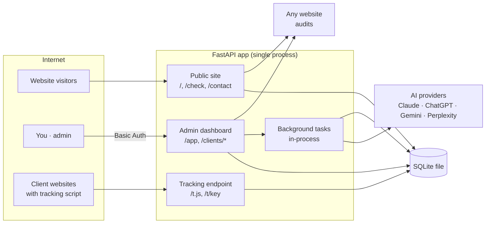
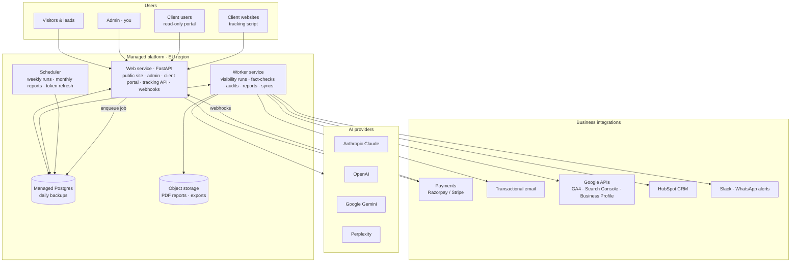
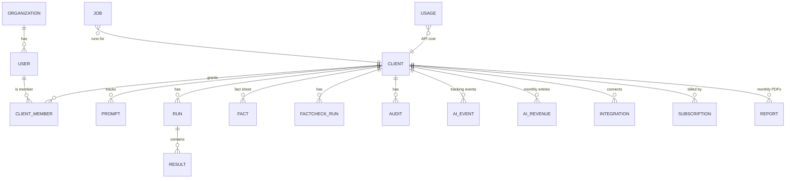
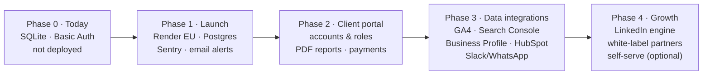

# 12 · System Architecture

**Status:** current state documented; target architecture proposed (owner to confirm hosting and payment choices).
**Context:** run by one person (with Claude) from India, serving clients worldwide. Admins plus a read-only client portal. Planned integrations: payments, email, Google data, CRM/LinkedIn, Slack/WhatsApp alerts.

> **In one paragraph:** ASO Engine is one Python web application (FastAPI). It serves the public website, the admin dashboard and, next, a client portal. It stores everything in one database and calls AI providers and other services over HTTPS. Today it runs on SQLite with a single admin login. The target keeps the same single application, but moves to managed Postgres, adds proper user accounts for clients, runs heavy work in a separate background worker, and is hosted on a managed platform in an EU region. The tech details are in [13 · Technical Architecture & Tech Stack](13-technical-architecture-and-stack.md).

---

## 1. Architecture principles
1. **One application, one database.** A "modular monolith" is the right size for a solo operator: one codebase, one deploy, no microservices.
2. **Server-rendered first.** HTML pages rendered on the server (fast, SEO-friendly, little JavaScript), with small bits of interactivity added only where needed.
3. **Managed over self-run.** Pay a little for managed hosting, database backups and email delivery rather than maintaining servers.
4. **Every client's data is isolated.** Each query is scoped to one client, and client users can only ever see their own client.
5. **Privacy by design.** Collect the minimum. The tracking script is anonymous, secrets are encrypted, and data lives in an EU region.
6. **Swap-friendly integrations.** Each external service sits behind one small module (`app/integrations/<name>.py`), so a provider can be replaced without touching the rest.

---

## 2. Current architecture (built today)

| Area | Today | Limitation |
|---|---|---|
| Framework | FastAPI + Jinja2 templates, one process | Long AI runs share the web process |
| Database | SQLite file (`DB_PATH`) | One writer at a time; backups are manual file copies; no migrations tool |
| Auth | HTTP Basic, single admin (`ADMIN_USER` / `ADMIN_PASSWORD`) | No client logins, no roles, no logout, no 2FA |
| Background work | FastAPI `BackgroundTasks` + cron (`run_all.py`) | Jobs are lost if the process restarts mid-run |
| Integrations | Anthropic SDK; OpenAI, Perplexity and Gemini over REST; website fetching | No payments, email, Google data, CRM or alerts yet |
| Rate limits | In-memory per process | Reset on restart; not shared across instances |
| Hosting | Not deployed yet (Dockerfile ready) | |

---

## 3. Target architecture

### How a typical job flows
1. You click **Run visibility check**, or the scheduler fires the weekly run.
2. The web service writes a row to the `jobs` table and returns immediately.
3. The worker picks up the job (Postgres `SELECT … FOR UPDATE SKIP LOCKED`), calls the AI providers, writes results, and records the API cost against the client.
4. When it finishes, the worker sends an alert (Slack, email or WhatsApp) if something important changed, such as a visibility drop or a new wrong fact.
5. Monthly, the worker renders each client's report to PDF, stores it, and emails the client a portal link.

---

## 4. Framework
- **FastAPI (Python)** stays. It's already built, it's fast, and the AI SDKs are first-class in Python.
- **Server-rendered Jinja2 templates + htmx** for interactivity in the dashboard and portal (filters, inline edits, live job status) without a separate JavaScript front-end.
- **Code organised by feature module:** `tracking`, `factcheck`, `revenue`, `audits`, `leads`, `billing`, `portal`, `integrations/*`. Each module owns its routes, templates and queries.
- **No separate SPA or mobile app.** The portal is responsive web.

## 5. Database
**Target: managed PostgreSQL**, with SQLAlchemy 2 for data access and Alembic for migrations. Keep SQLite for local development and tests.

| Decision | Choice | Why |
|---|---|---|
| Engine | PostgreSQL 16+ (managed) | Concurrent writes from web + worker, point-in-time backups, JSON columns, row locking for the job queue |
| When to switch | Before the client portal goes live (Phase 2), or at the first paying client, whichever comes first | SQLite is fine for demos and the first few clients |
| Job queue | A `jobs` table in Postgres | No Redis to run; enough for thousands of jobs a day |
| Files | Object storage (S3-compatible, e.g. Cloudflare R2) for PDFs and exports | Keeps the database small; signed links for downloads |
| Backups | Provider's daily backups + a weekly off-site dump | Protection against provider or operator error |

**Core data model (target)**

- `organization`: your agency (one row today; it leaves room for white-label partners later).
- `user` + `client_member`: who can log in, and which clients they can see, with which role.
- `integration`: connected accounts per client (Google, HubSpot), with OAuth tokens **encrypted at rest**.
- `usage`: tokens and cost per AI call per client, so you can see each client's margin.

## 6. Authentication & authorisation
**Target: built-in authentication.** Admins sign in with a password plus an authenticator-app code; clients use passwordless **magic links**. This avoids a per-user auth vendor and keeps everything in one app. Clerk or Auth0 can be added later if you need Google/Microsoft sign-in or SSO.

| Who | How they sign in | What they can do |
|---|---|---|
| **Owner** (you) | Email + password (Argon2 hashed) + TOTP 2FA | Everything, including billing and settings |
| **Staff** (future helper) | Same as owner | Manage clients, run checks; no billing or settings |
| **Client viewer** | Magic link by email (15-minute single-use link), optionally a password | Read-only: their own dashboard, reports, fact-check and revenue pages; download PDFs |

- **Sessions:** secure, HTTP-only, SameSite=Lax cookies; sessions stored server-side (revocable), 30-day sliding expiry for clients and 12 hours for admins.
- **CSRF protection** on every form; login rate-limited per IP and per email.
- **Tenant isolation:** every portal query is filtered by the client IDs in the user's `client_member` rows, enforced in one data-access layer, with automated tests that try to read another client's data.
- **Audit log** of admin actions (who ran, edited or deleted what).
- **Public endpoints** stay unauthenticated but protected: the free check (SSRF guard, rate limit), the tracking endpoint (site key, Origin check, rate limit) and webhooks (signature verification).

## 7. Integrations

| Integration | Purpose | Recommended provider | How it connects | Notes |
|---|---|---|---|---|
| **AI engines** (existing) | Visibility tracking, fact-check, strategy | Anthropic, OpenAI, Google Gemini, Perplexity | API keys (server-side) | Track tokens and cost per client in `usage`; set spending limits in each console |
| **Payments** | Invoices and monthly subscriptions, global clients | **Razorpay** (international payments enabled) as primary; Stripe if your account is approved; Wise/PayPal for bank-transfer clients | REST API + signed webhooks → `subscriptions` | See §8 for India export rules. Verify Stripe availability for Indian businesses before relying on it |
| **Transactional email** | Magic links, lead alerts, monthly report emails | **Postmark** or **Resend** | API + SPF, DKIM, DMARC on your domain | Separate "transactional" and "marketing" streams to protect deliverability |
| **Google Analytics 4** | AI referral traffic and conversions alongside the tracking script | Google Analytics Data API | OAuth 2.0 (client grants read-only access) | Store refresh tokens encrypted; Google may require OAuth app verification |
| **Google Search Console** | Real search queries, for building prompt sets and seeing Google demand | Search Console API | OAuth 2.0, read-only scope | Same OAuth app as GA4 |
| **Google Business Profile** | Hours, address and categories for local clients (feeds the fact sheet) | Business Profile APIs | OAuth 2.0 | **API access requires Google's approval**; apply early |
| **CRM** | Leads and deals pipeline | **HubSpot** (free CRM tier) | Private app token (your own HubSpot) | Sync website leads and LinkedIn prospects as contacts and deals |
| **LinkedIn** | Lead-generation engine (doc 07) | No automation: human-in-the-loop | Manual sending; optional Lead Gen Forms via the Marketing API (needs LinkedIn approval) | Never scrape or automate messages |
| **Slack** | Instant alerts to you | Slack incoming webhook | Webhook URL (secret) | New lead, visibility drop, wrong fact found, job failed |
| **WhatsApp** | Alerts to you (and optionally clients) | **WhatsApp Cloud API** (Meta) or Twilio | Business verification + approved message templates | Start with alerts to your own number; client messages need opt-in |
| **Object storage** | Report PDFs, exports | Cloudflare R2 (S3-compatible) | Access keys | Signed, expiring download links |
| **Error monitoring** | Know when something breaks | Sentry | DSN | Free tier is enough for a solo operator |

**Integration rules:** every integration has a timeout, retries with back-off, and a failure path that never crashes a page. Secrets live only in environment variables. Every inbound webhook is signature-verified and idempotent, so the same event processed twice causes no double effects.

## 8. Compliance (India-based, global clients)
- **GDPR / UK GDPR** for EU/UK clients and their visitors. You act as a **data processor** for client data. Have a Data Processing Agreement template and publish a list of sub-processors (hosting, email, AI providers). EU-region hosting simplifies this.
- **India DPDP Act 2023**: consent, purpose limitation, and breach notification for personal data you process.
- **Data minimisation:** the tracking script stores no personal data. Leads hold only what the forms collect. Retention: delete raw AI answers after 24 months and leads after 24 months without activity (adjustable).
- **AI providers:** send them only public website content and brand questions, never client customer data.
- **Payments and tax:** exporting services from India normally means GST at zero rate under a Letter of Undertaking (LUT), with inward-remittance proof (FIRA/e-FIRC) for foreign payments. **Confirm with a chartered accountant** before invoicing.

## 9. Hosting recommendation (running this as a service)

| Option | Best for | Pros | Cons |
|---|---|---|---|
| **Render: web + worker + cron + managed Postgres, Frankfurt region** ✅ *recommended* | A solo operator who wants it to just run | Deploys on every push to GitHub; web, background worker and cron as separate services; managed Postgres with backups; EU region for GDPR; predictable per-service pricing | Costs more than a bare VPS; less low-level control |
| Railway (EU region) | Similar to Render, usage-based billing | Very fast setup, good developer experience | Usage-based bills are less predictable |
| VPS (Hetzner, Germany) + Docker + Coolify | Lowest cost, hands-on | Cheapest for the resources; full control | You own updates, security, backups and monitoring |
| AWS / Google Cloud / Azure | Teams at larger scale | Unlimited scale and services | Too much setup and running cost for one person now |

**Recommendation: Render in the Frankfurt (EU) region.** Run one web service, one background worker, one cron job, managed Postgres, Cloudflare in front (DNS, TLS, caching for `t.js`) and Cloudflare R2 for files. Expect roughly $25–$60 a month at the start. Verify current prices on Render's pricing page; the cost model is in the "What It Will Cost to Run" document. The app ships as a Docker image, so moving to Railway or a VPS later is easy.

**Domains:** `www.<brand>.com` → public site · `app.<brand>.com` → admin + client portal · `t.<brand>.com` → tracking script and endpoint. A separate subdomain keeps ad-blocker lists and cookies cleanly apart.

## 10. Roadmap: from today to target

| Phase | Deliverables | Gate to move on |
|---|---|---|
| **1 · Launch** | Deploy on Render EU; Postgres + Alembic; jobs table + worker; Sentry; uptime monitor; lead email alerts; real API keys tested | Landing page live over HTTPS, the first real visibility and fact-check runs complete |
| **2 · Client portal** | Users, roles, magic links, 2FA for admin; tenant isolation tests; PDF reports to R2; monthly report emails; Razorpay invoices and subscriptions | First paying client can sign in and see only their data |
| **3 · Integrations** | Google OAuth app (GA4, Search Console, Business Profile); HubSpot sync; Slack and WhatsApp alerts; per-client API cost dashboard | 3+ clients connected, alerts firing correctly |
| **4 · Growth** | LinkedIn engine (doc 07); white-label partner organisations; optional self-serve sign-up and billing | Repeatable acquisition; decision on SaaS |
