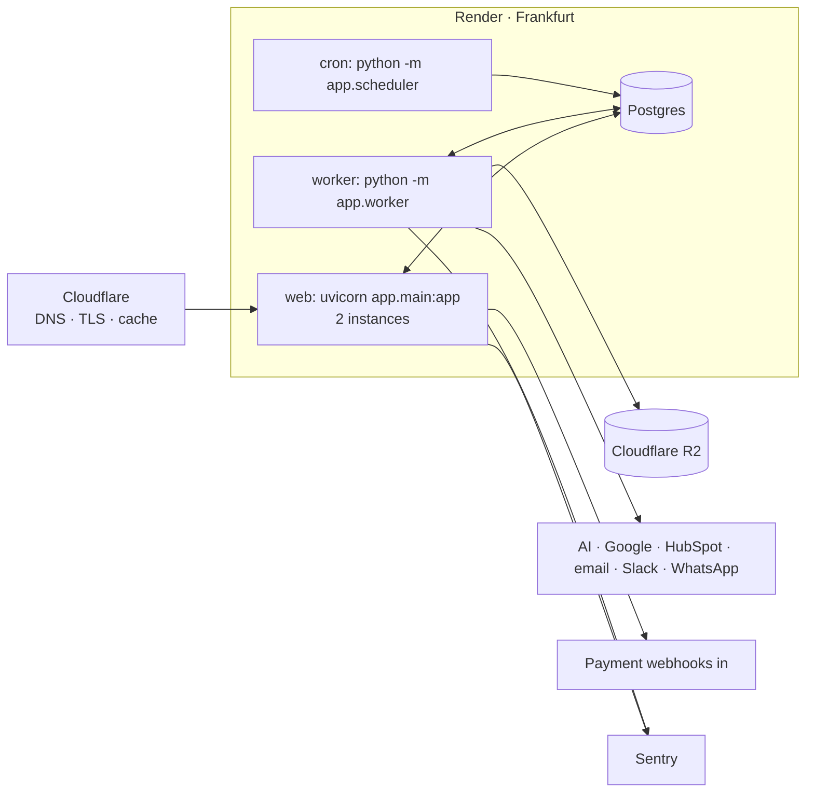

# 13 · Technical Architecture & Tech Stack

**Status:** current stack documented; planned additions marked with the phase they arrive in (phases as in [12 · System Architecture](12-system-architecture.md) §10).
**Replaces:** the earlier `03-tech-stack.md`.

> **Guiding rule:** one person (with Claude) must be able to understand, run and change every part of this. Choose boring, well-documented, Python-native tools. Add a new service only when a phase needs it.

---

## 1. Stack at a glance

| Layer | Technology | Status | Why this choice |
|---|---|---|---|
| Language | **Python 3.12+** | ✅ In use | Best-in-class AI SDKs; simple to read and change |
| Web framework | **FastAPI** + Uvicorn | ✅ In use | Fast, typed, async-ready; already built |
| Templates | **Jinja2** (server-rendered HTML) | ✅ In use | One deployable, fast pages, SEO-friendly |
| Interactivity | **htmx** (small JS attributes) | 🟡 Phase 2 | Live job status, inline edits and filters without a JS framework |
| Styling | Plain CSS + **design tokens** (`design/tokens.css`) | 🟡 Phase 1 | One source of truth for the brand (doc 14); no CSS build step |
| Database | SQLite → **PostgreSQL 16+** (managed) | ✅ SQLite / 🟡 Postgres in Phase 1 | Concurrency, backups, row locking for jobs |
| Data access | `sqlite3` → **SQLAlchemy 2.0** (Core + ORM) | 🟡 Phase 1 | Same code for SQLite (local) and Postgres (production) |
| Migrations | **Alembic** | 🟡 Phase 1 | Versioned schema changes; replaces `CREATE TABLE IF NOT EXISTS` |
| Background jobs | FastAPI BackgroundTasks → **Postgres `jobs` table + worker process** | 🟡 Phase 1 | Survives restarts; no Redis to run |
| Scheduling | cron + `run_all.py` → **platform cron job** | 🟡 Phase 1 | Weekly runs, monthly reports, token refresh |
| Auth | HTTP Basic → **sessions + Argon2 passwords + TOTP (admins) + magic links (clients)** | 🟡 Phase 2 | No per-user vendor fees; fits a server-rendered app |
| Auth libraries | `argon2-cffi`, `pyotp`, `itsdangerous` | 🟡 Phase 2 | Small, well-audited building blocks |
| Validation | **Pydantic v2** | ✅ In use (via FastAPI) | Request and response schemas, settings |
| Settings | `.env` loader → **pydantic-settings** | 🟡 Phase 1 | Typed config, fails fast on missing secrets |
| HTTP client | **httpx2** | ✅ In use | Sync and async, timeouts; required by the Anthropic SDK 1.x+ |
| HTML parsing | BeautifulSoup 4 | ✅ In use | Site audits, llms.txt generation |
| AI: Claude | **`anthropic` Python SDK** (web search tool, structured outputs, server-side fallbacks) | ✅ In use | Tracking, fact-check grading, action plans |
| AI: others | OpenAI Responses API, Gemini API, Perplexity API over REST | ✅ In use | No extra SDK dependencies; each behind one connector |
| Markdown | markdown-it-py | ✅ In use | Renders AI-written plans safely (raw HTML off) |
| PDF reports | **WeasyPrint** (HTML/CSS → PDF) | 🟡 Phase 2 | Reuses report templates; CSS paged media; no browser needed |
| File storage | **Cloudflare R2** (S3 API via `boto3`) | 🟡 Phase 2 | Cheap, no egress fees, signed links |
| Email | **Postmark** or **Resend** (HTTP API) | 🟡 Phase 1 | Strong deliverability; separate transactional stream |
| Payments | **Razorpay** (primary) / Stripe (if approved) | 🟡 Phase 2 | Global cards from an Indian business; webhooks |
| Google APIs | `google-auth` + Analytics Data API, Search Console API, Business Profile APIs | 🟡 Phase 3 | Official clients, OAuth 2.0 |
| CRM | HubSpot API (private app token) | 🟡 Phase 3 | Free CRM tier; contacts and deals sync |
| Alerts | Slack incoming webhooks; WhatsApp Cloud API | 🟡 Phase 3 | Instant notifications |
| Secrets encryption | `cryptography` (Fernet) | 🟡 Phase 3 | Encrypts OAuth refresh tokens at rest |
| Error monitoring | **Sentry** (`sentry-sdk[fastapi]`) | 🟡 Phase 1 | Know about failures before clients do |
| Uptime | Better Stack or UptimeRobot | 🟡 Phase 1 | Pings `/healthz` every minute |
| Logging | Python `logging` → JSON to stdout | 🟡 Phase 1 | The platform collects the logs; searchable |
| Testing | **pytest**, FastAPI `TestClient`, Playwright (browser) | 🟡 Phase 1 | Unit, route and end-to-end tests |
| Lint/format | **Ruff** (lint + format) | 🟡 Phase 1 | One fast tool; CI-enforced |
| Types | mypy (lenient start) | ⚪ Optional | Catch mistakes in data-access code |
| CI | **GitHub Actions** | 🟡 Phase 1 | Ruff + pytest on every pull request |
| Dependencies | `requirements.txt` → **uv** + `pyproject.toml` with a lock file | 🟡 Phase 1 | Reproducible installs, fast |
| Dependency updates | Dependabot | 🟡 Phase 1 | Weekly security updates as PRs |
| Container | Docker (`python:3.13-slim`) | ✅ Dockerfile exists | Same image locally and in production |
| Hosting | **Render, Frankfurt (EU)**: web + worker + cron + Postgres | 🟡 Phase 1 | See doc 12 §9 |
| Edge | **Cloudflare** (DNS, TLS, caching for `t.js`) | 🟡 Phase 1 | Free tier; DDoS protection |

✅ in use · 🟡 planned (phase) · ⚪ optional

---

## 2. Runtime architecture



| Process | Command | Scales | Does |
|---|---|---|---|
| `web` | `uvicorn app.main:app --host 0.0.0.0 --port $PORT --proxy-headers` | 1 → 2 instances | Pages, APIs, tracking events, webhooks; enqueues jobs. Never calls slow AI APIs while a request waits |
| `worker` | `python -m app.worker` | 1 (add more for throughput) | Claims jobs with `FOR UPDATE SKIP LOCKED`; 6 parallel AI calls per job; retries with back-off |
| `cron` | `python -m app.scheduler` (every 15 min) | 1 | Enqueues due weekly runs, monthly reports, token refreshes, cleanup |

**Jobs table (Phase 1):** `id, type, client_id, payload JSON, status (queued|running|done|failed), attempts, run_after, locked_at, error, created_at`. Job types: `visibility_run`, `factcheck_run`, `audit`, `monthly_report`, `crm_sync`, `google_sync`, `alert`.

---

## 3. Code structure

**Today**
| File | Responsibility |
|---|---|
| `app/main.py` | All routes: public site, free check, contact, admin dashboard, clients, runs, audits, reports, leads, fact-check, revenue, tracking |
| `app/config.py` | Settings from `.env`; **pricing packages** (`PRICING`) |
| `app/db.py` | SQLite schema and helpers |
| `app/engines.py` | One connector per AI engine, plus a demo engine |
| `app/analyzer.py` | Turns an AI answer into metrics |
| `app/tracker.py` | Runs every prompt × engine in parallel and stores the results |
| `app/auditor.py` | AI-readiness audit (17 checks, SSRF guard) and llms.txt generator |
| `app/factcheck.py` | AI Fact-Check: brand questions, Claude grading with structured JSON output, accuracy score, error sources |
| `app/revenue.py` + `app/static/t.js` | AI Revenue Report: tracking script, `/t/{key}` endpoint, monthly summaries |
| `app/advisor.py` | Claude-written action plans and prompt suggestions |
| `app/templates/` | Public pages (`landing.html`, `check_result.html`, `_site.css`) and admin pages |
| `run_all.py` | Cron entry point for weekly runs |

**Target (refactor gradually, one module per pull request)**
```
app/
  main.py              # creates the app, mounts routers, middleware
  settings.py          # pydantic-settings
  db/                  # SQLAlchemy engine, session, models; Alembic migrations in /migrations
  auth/                # users, sessions, magic links, TOTP, roles, CSRF
  portal/              # client read-only portal routes + templates
  public/              # landing, free check, contact
  modules/
    tracking/          # visibility runs, analyzer
    factcheck/
    revenue/           # incl. static/t.js
    audits/
    leads/
    billing/           # Razorpay/Stripe, webhooks
    reports/           # HTML → PDF, R2 upload, monthly email
  integrations/        # one file per external service: anthropic.py, openai.py, gemini.py,
                       # perplexity.py, email.py, razorpay.py, google.py, hubspot.py, slack.py, whatsapp.py
  worker.py            # job loop
  scheduler.py         # cron entry
design/                # tokens.css, components, templates (doc 14)
tests/                 # unit/, routes/, e2e/
```

---

## 4. Data model (current tables)
| Table | Key fields |
|---|---|
| `clients` | name, brand, aliases, domain, industry, competitors |
| `prompts` | client_id, text, category, active |
| `runs` / `results` | visibility runs; per prompt × engine: answer, citations, mentioned, cited, position, sentiment, competitors_mentioned, error |
| `audits` | client_id, url, score, data (JSON), ai_plan |
| `facts` | client_id, question, answer (client-approved fact sheet) |
| `factcheck_runs` / `factcheck_results` | per question × engine: answer, citations, verdict, explanation, wrong_claims |
| `tracking_sites` / `ai_events` / `ai_revenue` | site key; anonymous events (visit/lead, AI source, path); monthly customers, revenue, self-reported leads |
| `leads` | token, name, email, website, message, source, score, audit_data, status |

**Planned tables:** `organizations`, `users`, `client_members` (role per client), `sessions`, `login_tokens`, `audit_log` (Phase 2); `jobs`, `usage` (tokens and cost per AI call) (Phase 1); `subscriptions`, `invoices`, `reports` (Phase 2); `integrations` (encrypted OAuth tokens), `alerts` (Phase 3). The target relationships are drawn in doc 12 §5.

**Conventions:** UTC timestamps (`timestamptz`); integer primary keys internally plus random public tokens in URLs that clients see; `client_id` on every client-owned row with an index; soft-delete clients (`deleted_at`) and purge after 30 days; JSON columns only for API payloads, never for data you filter on.

## 5. Metrics definitions
| Metric | Definition |
|---|---|
| AI visibility | % of successful answers that mention the brand (name, alias or domain) |
| Share of voice | Brand mentions ÷ (brand + all tracked competitor mentions) |
| Citation rate | % of answers whose cited sources include the client's domain |
| Average position | Mean rank of the brand in list-style answers (or order of first mention) |
| Sentiment | Keyword-based positive/neutral/negative (Phase 3: Claude classification) |
| AI Accuracy Score | (correct + ½ × partly correct) ÷ answers that stated facts; "I don't know" answers are reported separately as coverage |
| AI leads | Tracked form leads attributed to an AI assistant (last 30 days) + self-reported AI leads |
| AI share of leads | Tracked AI leads ÷ all tracked leads |
| AI-readiness score | Weighted pass rate of 17 audit checks (0–100) |

## 6. AI provider usage
| Use | Provider / model | Settings |
|---|---|---|
| Visibility tracking (Claude engine) | Claude Opus 5.5 (`CLAUDE_MODEL`); Haiku 5.5 to cut cost | Web search tool (max 5 uses), effort `low`, `pause_turn` resume loop, server-side fallbacks |
| Fact-check grading | Claude, structured outputs (JSON schema) | Effort `low`; refusal and `max_tokens` checks before parsing |
| Action plans, prompt ideas, fact-sheet drafts | Claude, streaming | Effort `medium` |
| Other engines | OpenAI Responses API + web search; Gemini + Google Search grounding; Perplexity Sonar | Timeouts 120 s; errors captured per answer, never crash a run |

**Planned (Phase 1):** separate `CLAUDE_TRACKING_MODEL` and `CLAUDE_REASONING_MODEL` settings; log tokens and cost for every call to `usage`; a monthly budget per client that pauses runs when exceeded.

## 7. Environments & configuration
| Environment | Where | Database | Purpose |
|---|---|---|---|
| Local | Your PC (`E:\ASO GEO Engine`) | SQLite, `DEMO_MODE=1` | Development with simulated AI answers |
| Preview (optional) | Render pull-request previews | Throwaway Postgres | Click-test a change before merging |
| Production | Render Frankfurt | Managed Postgres | Clients |

**Configuration (environment variables):** branding (`AGENCY_*`), AI keys (`ANTHROPIC_API_KEY`, `OPENAI_API_KEY`, `PERPLEXITY_API_KEY`, `GEMINI_API_KEY`), model overrides, `DEMO_MODE`, `DATABASE_URL` (Phase 1), `SECRET_KEY` (sessions and signing), `ENCRYPTION_KEY` (OAuth tokens), `PUBLIC_URL`, `SENTRY_DSN`, `POSTMARK_TOKEN`/`RESEND_API_KEY`, `RAZORPAY_KEY_ID`/`RAZORPAY_KEY_SECRET`/`RAZORPAY_WEBHOOK_SECRET`, `R2_*`, `GOOGLE_OAUTH_CLIENT_ID`/`_SECRET`, `HUBSPOT_TOKEN`, `SLACK_WEBHOOK_URL`, `WHATSAPP_TOKEN`/`WHATSAPP_PHONE_ID`. Secrets live only in Render's environment settings and your local `.env`, never in Git.

## 8. Delivery workflow (solo + Claude)
1. A feature branch per change → pull request → **GitHub Actions** runs Ruff and pytest → you review → merge.
2. Merging to `main` auto-deploys to Render; Alembic migrations run in a pre-deploy command (`alembic upgrade head`).
3. Rollback = redeploy the previous image from Render's dashboard. Migrations must be backwards-compatible: add columns first, remove them in a later release.
4. Every new feature ships with: a test for its main path, a demo-mode path, docs updated in `/docs`, and the design rules in doc 14 followed.

## 9. Security checklist
- [x] SSRF guard on the public free check (private, loopback and internal IPs blocked, including after redirects)
- [x] Tracking endpoint: site key, `Origin` check, payload validation, no personal data stored
- [x] Rate limits per feature bucket (in memory) → **Phase 1:** move to Postgres or Cloudflare rate-limiting rules
- [x] `.env` never committed
- [ ] HTTPS only, HSTS, secure cookies (Phase 1)
- [ ] Sessions, CSRF tokens, Argon2, TOTP for admins, magic-link expiry and single use (Phase 2)
- [ ] Tenant-isolation tests: a client user cannot load another client's pages or PDFs (Phase 2)
- [ ] Webhook signature verification and idempotency keys (Phase 2)
- [ ] OAuth tokens encrypted with Fernet; least-privilege read-only scopes (Phase 3)
- [ ] Dependabot + `pip-audit` in CI (Phase 1)
- [ ] Daily database backups + a monthly restore test (Phase 1)
- [ ] Content-Security-Policy header on the portal (Phase 2)

## 10. Observability
- **Errors:** Sentry on `web` and `worker`, tagged with job type and client ID (never personal data).
- **Health:** a `/healthz` endpoint checks database connectivity; an uptime monitor alerts you on Slack.
- **Business signals:** a daily summary to Slack covering new leads, jobs failed, AI spend today and clients over budget.
- **Logs:** JSON lines with a request ID; no secrets, no full AI answers in logs.

## 11. Known limitations (today)
- AI answers vary between runs, so judge trends over several runs.
- API answers approximate, but don't exactly match, what users see in the consumer apps.
- Sentiment is keyword-based.
- Not yet tested against live AI APIs with real keys. **Do this first after deployment.**
- No automated tests yet; add pytest in Phase 1.
