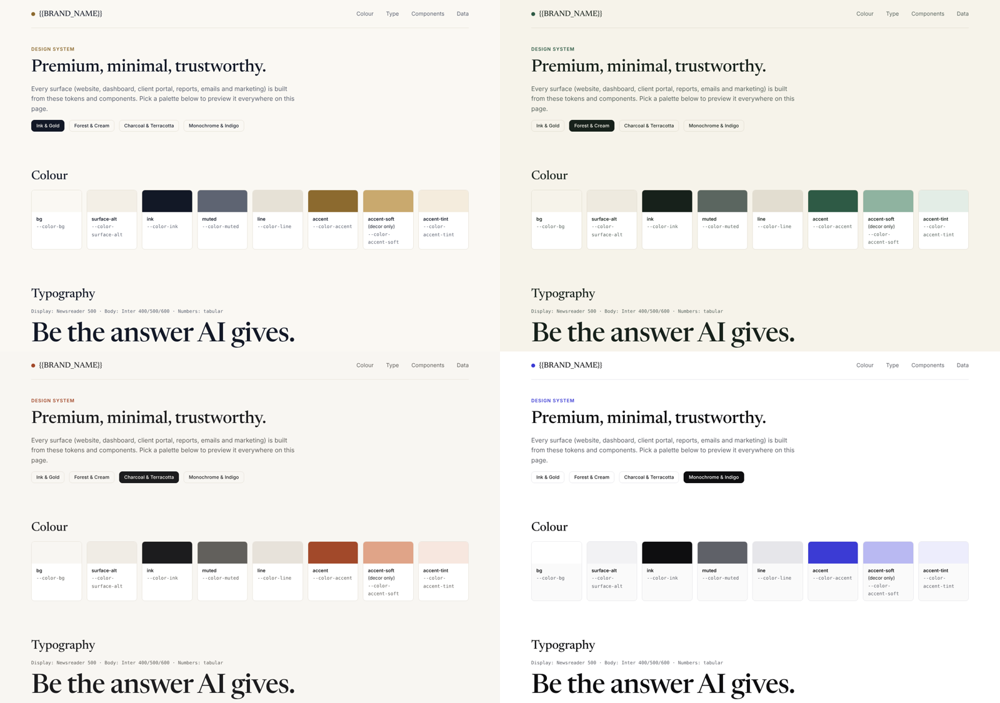

# 14 · Design System (Brand Guide)

**Style:** premium & minimal. **Status:** palette and brand name **to be decided**; `ink-gold` is the provisional default.

> Everything we make (website, dashboard, client portal, reports, emails, LinkedIn graphics) should feel like a calm, expert advisor: lots of white space, few colours, serif headlines, precise numbers, no hype.

**Files**
| File | What it is |
|---|---|
| `design/tokens.css` | Colours (4 palettes), fonts, type scale, spacing, radii, shadows. **The single source of truth.** |
| `design/components.css` | Buttons, forms, cards, KPIs, badges, tables, bars, callouts, claim-vs-truth, nav, app shell |
| `design/components.html` | Live gallery with a palette switcher. Open it in a browser to compare the options |
| `design/templates/landing.html` | Marketing / landing page |
| `design/templates/portal.html` | Dashboard and client-portal page |
| `design/templates/report.html` | A4 monthly report (print to PDF) |
| `design/templates/email.html` | Monthly report / alert email (inline styles) |
| `design/templates/social-post.html` | LinkedIn graphic, 1080×1080 |
| `.claude/skills/brand-design/` | The Claude Code skill: rules any future Claude session follows when building visuals |

---

## 1. Palette options: choose one

| Palette | Feel | Ink | Background | Accent | Accent contrast* |
|---|---|---|---|---|---|
| **Ink & Gold** (default) | Classic consultancy, high trust, quietly luxurious | `#121826` | `#FAF8F3` | `#8C6A2F` | 4.7:1 ✓ |
| **Forest & Cream** | Calm, distinctive, "grown-up" | `#17211B` | `#F6F3EA` | `#2E5A45` | 7.1:1 ✓ |
| **Charcoal & Terracotta** | Modern, editorial, warm | `#1C1C1E` | `#F8F6F2` | `#A2492A` | 5.5:1 ✓ |
| **Monochrome & Indigo** | Sharp, tech-forward, most "software" | `#0E0E10` | `#FFFFFF` | `#3B3BD4` | 7.6:1 ✓ |

*Accent text on the background; ✓ = passes WCAG AA (4.5:1). Every palette also has `surface`, `surface-alt`, `muted`, `line`, `accent-soft` (decoration only) and `accent-tint` values; see `tokens.css`.

**My recommendation: Ink & Gold.** It reads as established and premium to business owners, and it stands out from the blue-and-purple look most AI tools use. Forest & Cream is a strong second if you want something more distinctive.

**To switch:** set `data-palette="forest-cream"` (or another option) on the `<html>` tag. Every token-based page changes at once. For emails, replace the 6 hex values listed at the top of `email.html`.

## 2. Typography
| Role | Font | Use |
|---|---|---|
| Display | **Newsreader** (serif), weight 500 | H1–H3, KPI values, report summary, hero |
| Body / UI | **Inter**, 400/500/600 | Everything else; tabular numbers in data |

Scale: 12 · 14 · 16 · 18 · 24 · 32 · 44 px, plus a fluid hero (40–68px). Headlines in sentence case, never bold. One italic accent word per hero headline at most.

## 3. Layout & space
- Spacing scale: 4, 8, 12, 16, 24, 32, 48, 64, 96, 128 px. Use nothing else.
- Page width 1160px; text width 680px; gutter 20px.
- Marketing sections: 96–128px vertical padding. App pages: 48px.
- Radius: 4 / 8 / 14 px. Separate with 1px hairlines; shadows only for floating elements.

## 4. Brand name & mark
- **The name isn't decided yet.** Templates use `{{BRAND_NAME}}`; the app uses `AGENCY_NAME` from `.env`.
- Until a logo exists, the mark is a **wordmark in Newsreader with a small accent dot** before it (`.brand-mark`). It's simple, premium and easy to replace.
- When you choose a name, check doc 02 (naming checklist), set `AGENCY_NAME`, and replace `{{BRAND_NAME}}` in `design/templates/`.

## 5. Components (summary)
Buttons (ink primary · accent for the main conversion · ghost secondary · arrow text link), form fields, cards (standard, quiet, feature with ink top-rule), KPIs (label · serif value · delta), badges (good/warn/bad/neutral/accent), tables (ink header rule, hairline rows, right-aligned numbers), progress bars, callouts, claim-vs-truth blocks for Fact-Check, nav, and the app shell with sidebar. All are shown in `design/components.html`.

## 6. Surfaces
| Surface | Key rules | Detail |
|---|---|---|
| Website & landing pages | Typography is the hero; one accent focal point per screen; real proof only | `.claude/skills/brand-design/references/website.md` |
| Dashboard & client portal | KPI row first; calm tables; portal is read-only and plain-English | `references/dashboard-and-portal.md` |
| Reports & PDFs | Cover · summary sentence · claims · tables · next steps; A4; a takeaway above every table | `references/reports-and-pdf.md` |
| Email, LinkedIn, decks | One message, one number, one button; stats only from real data | `references/marketing-and-email.md` |
| Copy | Calm senior advisor; plain English; no guarantees; British spelling | `references/voice-and-copy.md` |

## 7. Accessibility
Text contrast ≥ 4.5:1 (all palettes pass), visible focus outlines, 44px tap targets, works at 390px width without horizontal scroll, `prefers-reduced-motion` respected, and colour never the only signal (badges also carry words, deltas carry ▲/▼).

## 8. Don'ts
No gradients, glows, emoji, exclamation marks, robot or brain imagery, stock photos of people at laptops, more than one accent focal point, bold serif headlines, or invented statistics.

## 9. Migration of the current app
The existing app pages (`app/templates/*`) still use the earlier Inter-and-indigo style. Move them to this system page by page: landing and free-check result first (customer-facing), then the client report, then the admin pages. This is listed in the decisions log.
